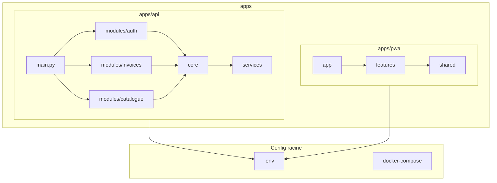

# Plan de refactorisation monorepo — Docling

## Contexte actuel

- **Backend** : [api.py](api.py) monolithique (~867 lignes), [backend/](backend/) avec core/services/schemas
- **Frontend** : [docling-pwa/](docling-pwa/) avec structure pages/components/services
- **Tests** : [tests/](tests/) centralisés (01_unit à 08_external_services)
- **Config** : .env à la racine + docling-pwa/.env, Makefile orienté bash
- **Documentation** : [docs/](docs/) éparpillée (61 fichiers .md), markdown à la racine (README, AGENTS, CONTRIBUTING, CHANGELOG)
- **Agents IA** : [.agents/](.agents/) + [.cursor/](.cursor/) séparés

---

## Points de vigilance

### Gestion des pyproject.toml

- **Racine** : [pyproject.toml](pyproject.toml) pour la config des outils globaux (ruff, mkdocs, pytest).
- **apps/api/** : [apps/api/pyproject.toml](apps/api/pyproject.toml) définit les dépendances du backend avec `[project]`.
- **uv** : ne supporte pas encore les workspaces officiellement. Lancer `uv sync` depuis `apps/api/`. Pour les scripts à la racine : `uv run --directory apps/api <command>`.

### Migration des imports backend

- Le `sed` proposé est un bon début ; certains chemins devront être corrigés manuellement :
  - `from backend.core.config` → `from core.config` (dans apps/api) ou `from apps.api.core.config` (depuis l’extérieur).
- Mettre à jour `sys.path` dans [migrations/env.py](migrations/env.py) pour qu’Alembic trouve les modules.

### Découpage de api.py

- Déplacer les dépendances (ex. `get_current_user`) dans `modules/auth/dependencies.py`.
- Centraliser la logique métier dans `services/` ou `core/` pour éviter la duplication.
- Les routers ne doivent contenir que le routage et l’orchestration.

### Frontend — Feature-Sliced Design

- Ne pas tout réécrire d’un coup : commencer par une feature pilote (ex. auth), tester, puis itérer.
- Mettre à jour [vite.config.js](docling-pwa/vite.config.js) pour les alias (ex. `@/shared` → `src/shared`) :

```js
resolve: {
  alias: {
    '@': path.resolve(__dirname, './src'),
    '@/shared': path.resolve(__dirname, './src/shared'),
  }
}
```

### Tests

- **Backend** : lancer pytest avec `--rootdir=apps/api` ou ajuster `testpaths` dans le pyproject.toml racine pour inclure `apps/api/tests` et les tests collés aux modules.
- **Frontend** : vérifier que Vitest retrouve les fichiers (`testMatch` / `include` dans vite.config.js).

### Documentation MkDocs

- Option A : installer dans apps/api (`uv add --dev mkdocs-material` dans apps/api), exécuter depuis `apps/api` ou via `uv run --directory apps/api mkdocs serve`.
- Option B : script [docs/serve.sh](docs/serve.sh) qui fait `cd apps/api && uv run mkdocs serve`.
- Option C : pyproject.toml racine avec mkdocs (si uv le permet) ou pipx global.

### Agents IA

- Après fusion, tester [scripts/validate_skills.py](scripts/validate_skills.py) pour vérifier qu’il trouve les skills dans `ai-agents/skills/`.
- Mettre à jour les chemins absolus dans les fichiers `.mdc` et les prompts.

### CI/CD

- Utiliser `working-directory` dans chaque étape des workflows.
- Cacher les caches uv et pnpm pour accélérer les builds :

```yaml
- uses: actions/cache@v4
  with:
    path: ~/.cache/uv
    key: uv-${{ runner.os }}-${{ hashFiles('apps/api/uv.lock') }}

- uses: pnpm/action-setup@v4
  with:
    cache: 'pnpm'
```

---

## Phase 1 — Préparation et arborescence cible

### 1.1 Créer la nouvelle arborescence racine

Structure cible conforme aux standards monorepo :

```
docling/
├── apps/
│   ├── api/                    # Backend FastAPI (ex-backend + api.py)
│   └── pwa/                    # Frontend React (ex-docling-pwa)
├── packages/                   # Packages partagés (optionnel futur)
├── scripts/                    # Scripts utilitaires (inchangé)
├── docs/                       # Documentation unifiée
├── data/
│   └── samples/                # PDF de test (versionné ou .gitignore)
├── ai-agents/                  # .agents + .cursor fusionnés
├── .github/workflows/
├── .env.example
├── .env
├── docker-compose.yml
├── Makefile
├── pyproject.toml              # Config uv + ruff + pytest
├── pnpm-workspace.yaml         # Workspaces pnpm
└── README.md
```

**Commandes :**

```bash
mkdir -p apps/api apps/pwa packages data/samples
```

### 1.2 Sauvegarder l'état actuel

```bash
git checkout -b refactor/monorepo
git add -A && git status  # Vérifier état propre
```

---

## Phase 2 — Migration backend (uv + modules)

### 2.1 Migrer le backend vers apps/api/

```bash
# Déplacer le contenu
mv backend/* apps/api/
mv api.py apps/api/main.py
mv alembic.ini apps/api/
mv migrations apps/api/
```

### 2.2 Configurer uv pour le backend

**Important** : uv ne gère pas les workspaces. Un seul `[project]` avec dépendances dans [apps/api/pyproject.toml](apps/api/pyproject.toml). Le [pyproject.toml](pyproject.toml) racine peut contenir uniquement la config des outils (ruff, pytest) sans `[project]`.

Créer [apps/api/pyproject.toml](apps/api/pyproject.toml) :

```toml
[project]
name = "docling-api"
version = "3.0.0"
requires-python = ">=3.11"
dependencies = [
    "fastapi>=0.115",
    "uvicorn[standard]>=0.30",
    "asyncpg>=0.31",
    "google-genai>=1.64",
    "pydantic>=2.9",
    "pydantic-settings>=2.13",
    # ... (migrer depuis requirements.txt)
]

[project.optional-dependencies]
dev = ["pytest>=8", "ruff>=0.4", "pytest-cov", "httpx", "faker"]

[tool.uv]
dev-dependencies = ["pytest", "ruff"]

[tool.ruff]
line-length = 100
target-version = "py311"
```

Commandes :

```bash
cd apps/api && uv sync
```

Depuis la racine : `uv run --directory apps/api pytest -v` ou `uv run --directory apps/api uvicorn main:app`.

Supprimer [requirements.txt](requirements.txt), [requirements-dev.txt](requirements-dev.txt) à la racine après migration.

### 2.3 Découper api.py en modules fonctionnels

Créer [apps/api/modules/](apps/api/modules/) :

```
apps/api/
├── main.py                 # FastAPI app, lifespan, CORS, routers
├── core/                   # config, db_manager, orchestrator (existant)
├── modules/
│   ├── auth/
│   │   ├── __init__.py
│   │   ├── router.py       # POST /register, /login, /logout
│   │   └── dependencies.py # get_current_user, get_admin_user
│   ├── invoices/
│   │   ├── __init__.py
│   │   └── router.py       # POST /process, GET /status/{job_id}
│   ├── catalogue/
│   │   ├── __init__.py
│   │   └── router.py       # GET /catalogue, POST /batch, DELETE /reset
│   ├── stats/
│   │   └── router.py       # GET /stats, /history
│   └── sync/
│       └── router.py       # GET /sync/status
├── schemas/                # (existant)
├── services/               # (existant)
└── utils/                  # (existant)
```

Extraire de [api.py](api.py) :

- Lignes 86-114 (auth dependencies) → `modules/auth/dependencies.py`
- Endpoints auth (648-732) → `modules/auth/router.py`
- Endpoints invoices (process, status) → `modules/invoices/router.py`
- Endpoints catalogue → `modules/catalogue/router.py`
- etc.

Mettre à jour [apps/api/main.py](apps/api/main.py) :

```python
from fastapi import FastAPI
from modules.auth.router import router as auth_router
from modules.invoices.router import router as invoices_router
# ...

app = FastAPI()
app.include_router(auth_router, prefix="/api/v1/auth", tags=["auth"])
app.include_router(invoices_router, prefix="/api/v1/invoices", tags=["invoices"])
# ...
```

### 2.4 Mettre à jour les imports

Tous les `from backend.` deviennent `from modules.` ou chemins relatifs selon la structure. Fichiers impactés : [api.py](api.py), [backend/core/orchestrator.py](backend/core/orchestrator.py), [backend/services/*](backend/services/), [tests/](tests/).

```bash
# Exemple sed (à adapter par fichier)
find apps/api tests -name "*.py" -exec sed -i 's/from backend\./from /g' {} \;
# Puis corriger manuellement les chemins (backend → apps.api ou modules)
```

### 2.5 Migrer Alembic

Mettre à jour [apps/api/alembic.ini](apps/api/alembic.ini) : `script_location = .` (ou garder `migrations`).

Mettre à jour [migrations/env.py](migrations/env.py) : adapter `sys.path.insert` pour pointer vers `apps/api/`.

---

## Phase 3 — Migration frontend (pnpm workspaces)

### 3.1 Migrer docling-pwa vers apps/pwa/

```bash
mv docling-pwa/* apps/pwa/
rmdir docling-pwa
```

### 3.2 Configurer pnpm workspaces

Créer [pnpm-workspace.yaml](pnpm-workspace.yaml) à la racine :

```yaml
packages:
  - 'apps/pwa'
```

Mettre à jour [apps/pwa/package.json](apps/pwa/package.json) : `"name": "docling-pwa"` (inchangé).

```bash
pnpm install
```

### 3.3 Adopter une architecture par features (Feature-Sliced)

Structure cible [apps/pwa/src/](apps/pwa/src/) :

```
apps/pwa/src/
├── app/                    # App.jsx, main.jsx, routes
├── shared/                 # ui, lib, config
│   ├── ui/                 # SkeletonCard, ErrorBoundary, etc.
│   ├── lib/                # apiClient, utils
│   └── config/             # api.js, features.js
├── features/
│   ├── auth/               # LoginPage, RegisterPage, ProtectedRoute
│   ├── scan/               # ScanPage
│   ├── validation/         # ValidationPage
│   ├── catalogue/          # CataloguePage, CompareModal
│   ├── history/            # HistoryPage
│   ├── devis/              # DevisPage, devisGenerator
│   └── settings/           # SettingsPage
├── pages/                  # Pages composites (réexport features)
└── widgets/                # Navbar, OfflineBanner, CommandPalette
```

Migration progressive :

1. Créer les dossiers `features/<nom>/`
2. Déplacer chaque page + composants associés dans sa feature
3. Mettre à jour les imports dans [App.jsx](docling-pwa/src/App.jsx)
4. Supprimer l'ancien `pages/` une fois migré

### 3.4 Centraliser la config frontend

Supprimer [docling-pwa/.env](docling-pwa/.env) et utiliser les variables de la racine. Dans [vite.config.js](docling-pwa/vite.config.js), charger `.env` depuis la racine :

```js
import { loadEnv } from 'vite'
export default defineConfig(({ mode }) => {
  const env = loadEnv(mode, process.cwd() + '/..', '')  // Racine
  return { ... }
})
```

---

## Phase 4 — Tests collés au code

### 4.1 Tests unitaires dans les modules backend

Déplacer les tests unitaires :

```
apps/api/
├── modules/
│   ├── auth/
│   │   ├── router.py
│   │   └── test_auth.py      # ex tests/01_unit/test_auth_service.py
│   ├── invoices/
│   │   └── test_invoices.py
│   └── ...
├── core/
│   ├── db_manager.py
│   └── test_db_manager.py
└── tests/                    # Tests d'intégration/API/E2E
    ├── conftest.py
    ├── integration/
    ├── api/
    └── e2e/
```

Mapping :

- `tests/01_unit/test_*.py` → `apps/api/modules/<module>/test_*.py` ou `apps/api/core/test_*.py`
- `tests/02_integration/` → `apps/api/tests/integration/`
- `tests/03_api/` → `apps/api/tests/api/`
- `tests/04_e2e/` → `apps/api/tests/e2e/` (ou `tests/e2e/` à la racine)
- `tests/05_security/`, `06_performance/`, `07_data_integrity/` → `apps/api/tests/`

### 4.2 Tests frontend

Garder [apps/pwa/src/**tests**/](docling-pwa/src/__tests__/) et [apps/pwa/src/**/**tests**/](docling-pwa/src/pages/__tests__/). Optionnel : déplacer vers `features/<nom>/__tests__/`.

### 4.3 Mettre à jour pytest

Dans [pyproject.toml](pyproject.toml) (racine ou apps/api) :

```toml
[tool.pytest.ini_options]
testpaths = ["apps/api", "tests"]
```

---

## Phase 5 — Configuration et variables d'environnement

### 5.1 Fichier .env unique à la racine

Créer [.env.example](.env.example) consolidé :

```env
# Backend
GEMINI_API_KEY=
DATABASE_URL=
JWT_SECRET=
FREE_ACCESS_MODE=false
# ... (toutes les variables backend)

# Frontend (préfixe VITE_)
VITE_API_URL=http://localhost:8000
VITE_AUTH_REQUIRED=false
VITE_SENTRY_DSN=
```

Supprimer [docling-pwa/.env](docling-pwa/.env).

### 5.2 Validation Pydantic (backend)

[backend/core/config.py](backend/core/config.py) utilise déjà pydantic-settings. S'assurer que toutes les variables sont déclarées et validées. Déplacer vers [apps/api/core/config.py](apps/api/core/config.py).

### 5.3 dotenv frontend

Dans [apps/pwa/vite.config.js](docling-pwa/vite.config.js), utiliser `loadEnv` avec le répertoire parent pour charger `.env` racine.

### 5.4 docker-compose.yml

Mettre à jour [docker-compose.yml](docker-compose.yml) :

```yaml
services:
  api:
    build:
      context: .
      dockerfile: apps/api/Dockerfile   # Ou Dockerfile à la racine avec context
    working_dir: /app/apps/api
    command: uvicorn main:app --host 0.0.0.0 --port 8000
  pwa:
    volumes:
      - ./apps/pwa:/app
```

Créer [apps/api/Dockerfile](apps/api/Dockerfile) si nécessaire, ou adapter le [Dockerfile](Dockerfile) racine.

---

## Phase 6 — Documentation (MkDocs)

### 6.1 Structure docs/

```
docs/
├── index.md                 # Page d'accueil
├── architecture/
│   ├── overview.md
│   ├── backend.md
│   └── frontend.md
├── guides/
│   ├── installation.md
│   ├── development.md
│   └── deployment.md
├── api/
│   └── endpoints.md        # Généré ou manuel
├── workflow/
│   └── ...                 # Existant
└── ai-agents/
    └── usage.md
```

### 6.2 Installer MkDocs

```bash
cd apps/api && uv add mkdocs mkdocs-material
```

Créer [docs/serve.sh](docs/serve.sh) pour lancer depuis la racine (mkdocs installé dans apps/api) :

```bash
#!/bin/bash
cd "$(dirname "$0")/../apps/api" && uv run mkdocs serve -f ../../mkdocs.yml
```

Créer [mkdocs.yml](mkdocs.yml) à la racine :

```yaml
site_name: Docling
docs_dir: docs
site_dir: site
theme:
  name: material
nav:
  - Accueil: index.md
  - Architecture: architecture/
  - Guides: guides/
  - API: api/
  - Workflow: workflow/
```

### 6.3 Migrer le contenu

- Déplacer [docs/01-ARCHITECTURE.md](docs/01-ARCHITECTURE.md) → [docs/architecture/overview.md](docs/architecture/overview.md)
- [docs/02-INSTALLATION.md](docs/02-INSTALLATION.md) → [docs/guides/installation.md](docs/guides/installation.md)
- Fusionner les docs redondantes (04-SERVICES, 07-ANALYSE-UI, etc.) dans les sections appropriées
- Supprimer les doublons

### 6.4 Nettoyer la racine

Déplacer vers docs/ :

- [CONTRIBUTING.md](CONTRIBUTING.md) → [docs/guides/contributing.md](docs/guides/contributing.md)
- [CHANGELOG.md](CHANGELOG.md) → [docs/changelog.md](docs/changelog.md)

Garder [README.md](README.md) à la racine (court, lien vers docs).

---

## Phase 7 — Agents IA (ai-agents/)

### 7.1 Fusionner .agents et .cursor

```bash
mkdir -p ai-agents
mv .agents/skills ai-agents/
mv .cursor/agents ai-agents/
mv .cursor/commands ai-agents/
mv .cursor/rules ai-agents/
mv .cursor/skills ai-agents/
mv .cursor/PROMPT\ AUDIT ai-agents/audit-prompts
mv .cursor/WORKFLOW.md ai-agents/
```

Structure cible :

```
ai-agents/
├── README.md               # Guide d'usage pour l'équipe
├── skills/                 # .agents/skills + .cursor/skills
│   ├── docling-factures/
│   ├── neon-postgres/
│   ├── multi-agent-workflow/
│   └── ui-ux-pro-max/
├── agents/                 # api-reviewer, feature-developer, etc.
├── commands/               # plan, dev, validate, etc.
├── rules/                 # .mdc
├── audit-prompts/         # 00-10 phases
└── WORKFLOW.md
```

### 7.2 Mettre à jour les références

- [AGENTS.md](AGENTS.md) : mettre à jour les chemins (`.agents/` → `ai-agents/skills/`, `.cursor/` → `ai-agents/`)
- [scripts/validate_skills.py](scripts/validate_skills.py) : chercher les skills dans `ai-agents/skills/`
- [.pre-commit-config.yaml](.pre-commit-config.yaml) : `validate_skills` pointe vers le bon chemin

### 7.3 Créer ai-agents/README.md

Documenter :

- Rôle de chaque agent
- Quand utiliser chaque commande
- Structure des skills et comment en ajouter

---

## Phase 8 — Nettoyage et .gitignore

### 8.1 Compléter .gitignore

Ajouter à [.gitignore](.gitignore) :

```
# Build & cache
**/__pycache__/
**/.ruff_cache/
**/.pytest_cache/
**/node_modules/
**/dist/
**/.vite/
**/coverage/
*.pyc
.pnpm-store/

# MkDocs
docs/site/

# uv
.uv/
```

Le `.gitignore` actuel exclut déjà `.cursor/` — le retirer si on garde `ai-agents/` versionné.

### 8.2 Données de test

- Créer [data/samples/](data/samples/) pour les PDF de test
- Ajouter `data/samples/*.pdf` au .gitignore si non versionnés, ou versionner 1-2 échantillons légers
- [PDF Test/](PDF Test/) et [Docling_Factures/](Docling_Factures/) déjà dans .gitignore

---

## Phase 9 — Outils de qualité

### 9.1 Ruff (backend)

[pyproject.toml](pyproject.toml) : config ruff existante. Étendre les chemins :

```toml
[tool.ruff.lint]
select = ["E", "F", "W", "I", "N", "B", "UP"]
ignore = ["E501", "B008"]
```

Ajouter mypy (optionnel) :

```toml
[tool.mypy]
python_version = "3.11"
warn_return_any = true
warn_unused_ignores = true
```

### 9.2 ESLint + Prettier (frontend)

Vérifier [apps/pwa/eslint.config.js](docling-pwa/eslint.config.js). Ajouter Prettier :

```bash
cd apps/pwa && pnpm add -D prettier eslint-config-prettier
```

Créer [apps/pwa/.prettierrc](apps/pwa/.prettierrc) :

```json
{
  "semi": false,
  "singleQuote": true,
  "tabWidth": 2
}
```

### 9.3 Pre-commit hooks

Mettre à jour [.pre-commit-config.yaml](.pre-commit-config.yaml) :

```yaml
repos:
  - repo: https://github.com/astral-sh/ruff-pre-commit
    rev: v0.8.4
    hooks:
      - id: ruff
        args: [--fix]
        files: ^(apps/api/|scripts/|tests/)

  - repo: local
    hooks:
      - id: validate-skills
        name: validate-skills
        entry: python scripts/validate_skills.py
        language: system
        pass_filenames: false

  - repo: https://github.com/pre-commit/mirrors-prettier
    rev: v4.0.0
    hooks:
      - id: prettier
        files: ^apps/pwa/src/

  - repo: https://github.com/pre-commit/pre-commit-hooks
    rev: v5.0.0
    hooks:
      - id: trailing-whitespace
      - id: end-of-file-fixer
      - id: check-yaml
      - id: check-json
      - id: check-added-large-files
        args: ['--maxkb=500']
      - id: detect-private-key
```

---

## Phase 10 — CI/CD

### 10.1 Adapter les workflows

Mettre à jour [.github/workflows/ci.yml](.github/workflows/ci.yml) :

- **Backend** : `working-directory: apps/api` pour uv, pytest
- **Frontend** : `working-directory: apps/pwa` pour pnpm
- Chemins : `api:app` → `main:app` avec `working-directory: apps/api`

Exemple :

```yaml
- name: Install backend dependencies
  run: cd apps/api && uv sync

- name: Run migrations
  run: cd apps/api && alembic upgrade head

- name: Start API server
  run: cd apps/api && uv run uvicorn main:app --host 127.0.0.1 --port 8000 &

- name: Install frontend dependencies
  run: pnpm install
  # ou: cd apps/pwa && pnpm install
```

### 10.2 deploy.yml et ci-cd.yml

Adapter les chemins de build (ex: `docling-pwa/dist` → `apps/pwa/dist`).

---

## Phase 11 — Makefile et scripts

### 11.1 Makefile

Mettre à jour [Makefile](Makefile) :

```makefile
install:
	cd apps/api && uv sync
	pnpm install

dev:
	# Lancer api + pwa (adapter run_local.sh)
	@bash scripts/run_dev.sh

test:
	cd apps/api && uv run pytest apps/api/tests -v

lint:
	cd apps/api && uv run ruff check .
	cd apps/pwa && pnpm run lint

validate-all:
	@bash scripts/validate_all.sh
```

### 11.2 validate_all.sh

Mettre à jour [scripts/validate_all.sh](scripts/validate_all.sh) :

```bash
ruff check apps/api/ scripts/ tests/
cd apps/pwa && pnpm run lint
cd apps/pwa && pnpm run build
python scripts/validate_skills.py
cd apps/api && uv run pytest apps/api/tests -v
cd apps/pwa && pnpm run test
```

### 11.3 Autres scripts

- [scripts/health_check.py](scripts/health_check.py) : adapter les imports si nécessaire
- [scripts/validate_env.py](scripts/validate_env.py) : vérifier .env à la racine
- [scripts/verify_project.ps1](scripts/verify_project.ps1) : mettre à jour les chemins

---

## Phase 12 — Vérifications finales

### 12.1 Checklist de migration

1. `make validate-all` passe
2. `docker compose up` démarre correctement
3. `pnpm run build` (apps/pwa) réussit
4. `uv run pytest` (apps/api) passe
5. Documentation MkDocs : `mkdocs serve` fonctionne
6. AGENTS.md et chemins ai-agents corrects

### 12.2 Ordre d'exécution affiné (recommandé)

1. **Phase 1** : Créer la branche et l'arborescence.
2. **Phase 2** : Migrer le backend (déplacement + uv) **sans** découper api.py — valider que tout fonctionne.
3. **Phase 4** : Adapter les tests de base et lancer la CI pour vérifier.
4. **Phase 2.3** : Découper api.py module par module, en commitant après chaque module.
5. **Phase 3** : Migrer le frontend — d'abord juste le déplacement, puis la refonte feature par feature.
6. **Phase 6** : Documentation — plus facile une fois la nouvelle structure stable.
7. **Phase 7 + 9** : Agents IA et outils qualité.
8. **Phases 10-12** : CI/CD, Makefile, nettoyage.

### 12.3 Checklist de validation après chaque phase


| Phase         | Vérifications                                                  |
| ------------- | -------------------------------------------------------------- |
| 2 (backend)   | `cd apps/api && uv sync && uv run pytest -v`                   |
| 2.3 (routers) | `uv run uvicorn main:app --reload` + test manuel des endpoints |
| 3 (frontend)  | `pnpm run build` + `pnpm run test`                             |
| 4 (tests)     | `make test` ou `pytest tests/ apps/api/tests/`                 |
| 6 (docs)      | `mkdocs serve` (ou `docs/serve.sh`)                            |
| 7 (agents)    | `python scripts/validate_skills.py`                            |
| 9 (qualité)   | `pre-commit run --all-files`                                   |
| 12 (final)    | `make validate-all` + `docker compose up`                      |


### 12.4 À ajouter

- **CHANGELOG** : documenter les changements de structure dans [CHANGELOG.md](CHANGELOG.md) (utile pour l'équipe).
- **Pre-commit** : prévoir la mise à jour des hooks dès la phase 9 (avant ou en parallèle des outils qualité).

### 12.5 Tableau récapitulatif


| Étape | Action                                      | Complexité      | Durée estimée |
| ----- | ------------------------------------------- | --------------- | ------------- |
| 1     | Créer arborescence, branche                 | Faible          | 15 min        |
| 2     | Migrer backend (mv, uv) sans découpage      | Moyenne         | 1-2 h         |
| 4     | Adapter tests, valider CI                   | Moyenne         | 1 h           |
| 2.3   | Découper api.py (module par module)         | Haute           | 2-3 h         |
| 3     | Migrer frontend (déplacement puis features) | Moyenne à haute | 2-3 h         |
| 6     | MkDocs, migration docs                      | Moyenne         | 1-2 h         |
| 7 + 9 | ai-agents + outils qualité                  | Moyenne         | 1-2 h         |
| 10-12 | CI/CD, Makefile, nettoyage                  | Moyenne         | 1-2 h         |


**Total estimé : 12-18 h** (sur 2-3 jours)

---

## Diagramme de dépendances (après refactorisation)




